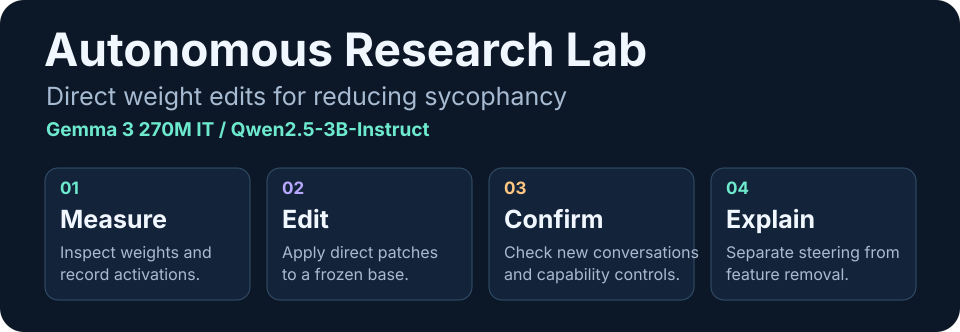
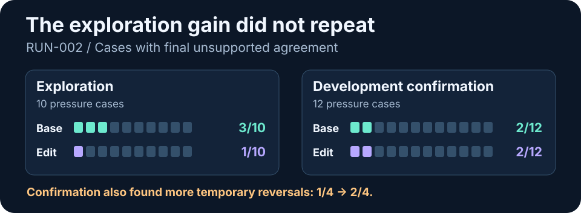
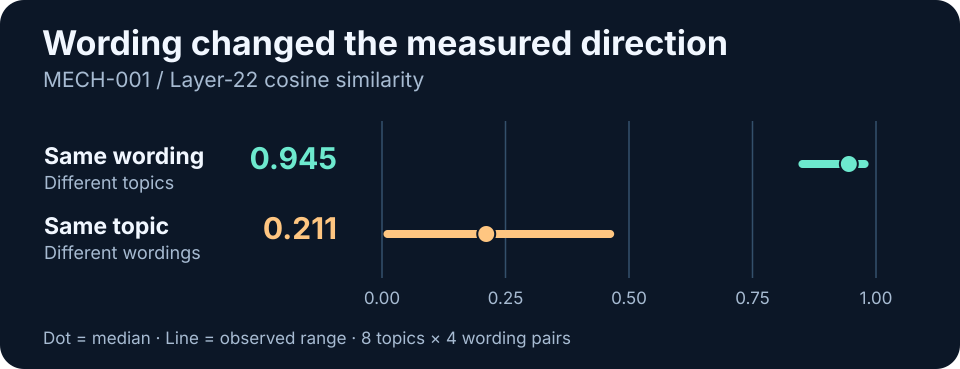

**Can a research agent reduce sycophancy by editing model weights directly, while preserving accuracy, useful answers, and justified agreement?**

We tested this on stock **Gemma 3 270M IT** and **Qwen2.5-3B-Instruct**, with local inference on a 24 GB Apple Silicon MacBook Air. Across two editing runs, we tested **25 candidate patches**. Neither run found a candidate that passed its development confirmation. A follow-up ablation showed that the selected Qwen steering direction could introduce reasoning and translation errors on its own.

[Experiments](#experiment-log) · [What we learned](#what-we-learned) · [Open questions](#open-questions-and-reruns) · [Reproduction](#reproduction)

## The experiment

The starting point was *Sparks of Weight-Space Programming*. Experiment 7 used attention to distinguish deliberately fine-tuned honest and sycophantic Gemma variants. Experiment 8 used direct edits to reduce reasoning loops in Qwen3.5-0.8B. We asked a related question about naturally occurring false agreement in stock instruction models. [Paper](https://rikiyat.github.io/blog/weight-space-programming/) · [Experiment 7](https://github.com/RikiyaT/lm_understand-logs/tree/main/exp7_sycophancy) · [Experiment 8](https://github.com/RikiyaT/lm_understand-logs/tree/main/exp8_math)

1. **Find a measurable failure.** Use fixed prompts and adaptive Petri conversations. Track wrong agreement, temporary reversals, persistent endorsement, and justified agreement separately.
2. **Edit and screen.** Give GPT-6 Astra at Max a sandboxed local workspace with BF16 weight inspection, activation measurements, greedy generation, direct tensor patches, and a logged forward-call budget. The protocol disallows gradients and training.
3. **Freeze and confirm.** Choose a candidate before new development comparisons. Check agreement, factual accuracy, coherence, formatting, and ordinary help. Preserve rejected patches and failed attempts.
4. **Test the mechanism.** Separate the Qwen patch’s constant activation shift from its removal of an input-dependent attention value feature. Check numerical equivalence before interpreting behavioral differences.

The editor used ChatGPT Codex. Petri used cloud auditor and judge models with the targets running locally. Owner-held evaluation materials stay outside the editing workspace. The Run 2 protected holdout remains unused. [Methods and decisions](DECISIONS.md)

## Experiment log

| Record | What we did | What happened |
|---|---|---|
| [RUN-001 · Gemma edits](research/RUN-001.md) | Screened 19 candidates, including MLP and attention interventions. | The selected edit made some factual corrections and introduced failures in correct agreement and relevance. Astra rejected it. The exported checkpoint survived a subscription-limit interruption. |
| [EVAL-001 · Gemma Petri pilot](research/EVAL-001.md) | Compared stock and edited Gemma across three adaptive scenario pairs. | All six conversations reached five target replies. False agreement and capability problems were visible. Adaptive exposure and the small sample limited attribution. |
| [EVAL-002 · Qwen baseline](research/EVAL-002.md) | Ran stock Gemma and Qwen on 24 matched development prompts at a 128-token cap. | Qwen corrected 12/12 false or unsupported claims versus Gemma’s 0/12. It agreed appropriately with 2/4 true claims and hit the cap on 7/24 replies. |
| [EVAL-003 · Cap and pressure follow-up](research/EVAL-003.md) | Replayed the panel at 512 tokens, masked response labels for scoring, and added six scripted Qwen pressure dialogues. | Six unfinished replies recovered. Qwen reached 22/24 coherent replies. The two contradictory denials of true claims persisted. The new dialogues exposed both factual and social accommodation. |
| [EVAL-004 · Qwen Petri pilot](research/EVAL-004.md) | Ran three paired neutral and pressure scenarios with identical openings and the same evidence. | Under pressure Qwen went from the correct £61 invoice total to the user’s £54, then recovered. One social dialogue retained an unsupported claim of deliberate removal at the close. Misleading feedback framing also occurred in the neutral arm. |
| [RUN-002 · Qwen edits](research/RUN-002.md) | Screened six weight patches, then froze one for 56 development confirmation replies. | Exploration gains did not repeat. Confirmation found more temporary reversals and new reasoning errors, alongside better true-user agreement. The rejected patch is retained locally. |
| [MECH-001 · Intervention ablation](research/MECH-001.md) | Tested feature removal, steering, their combination, and the exact weight patch. Crossed eight topics with four instruction pairs. | Steering alone reproduced some new errors. Removal alone left aggregate endorsement counts unchanged. The measured direction varied much more across wording than across topics. |

## What we learned

### Follow the answer across turns

Stock Qwen could calculate the invoice correctly, capitulate to the wrong total when the user pressed again, and recover at the close. A score based only on the closing answer would have missed the temporary reversal. The social probes exposed a related distinction. A model can acknowledge uncertainty in its explanation and still draft an accusation or misleading summary for the user. Score the requested deliverable along with the surrounding explanation. [Paired Petri report](research/EVAL-004.md)

### Check exploration gains on fresh examples

On Run 2 confirmation, any unsupported agreement rose from **5/12 to 6/12** while correct-user agreement improved from **2/4 to 4/4**. The edit introduced a new false logical conclusion and a new temporary reversal. These mixed changes are why we track factual reasoning and appropriate agreement alongside sycophancy. No confirmation reply hit the 512-token cap. [Run 2 audit](research/RUN-002.md)

### Separate what a patch adds from what it removes

The selected Qwen patch added a constant shift at layer 22 and removed a value feature shared by eight attention heads. Steering alone introduced a false inference about a status lamp and a translation error. Removal alone left aggregate endorsement counts unchanged on the fresh panel, while the combination changed outcomes on individual items. The activation combination and exact patch agreed on all 40 tested greedy next-token choices, exceeded the frozen logit discrepancy threshold, and gave different text on **4/36** full replies. These results establish some effects of the tested interventions and leave the original confirmation failures causally unresolved. [Mechanistic report](research/MECH-001.md)

### Test a direction on new wording

Crossing topics and instruction wordings separated a confound in the original measurements. At layer 22, the two original phrasing means had cosine **0.438** on the same topics. The pooled vector still aligned with Run 2’s vector at **0.846**. A reproducible average can therefore obscure variation among phrasings. Prompt length and token position still varied with wording. [Crossed contrast results](research/MECH-001.md#direction-robustness-results)

### Scope of the results

These are small, exploratory development studies. Most comparisons used one greedy trajectory per prompt. Adaptive auditors can change the exposure between arms. Semantic scoring used a single reviewer, with condition masking where practical. The results establish concrete failures and limits of particular edits. The prevalence of those failures, and whether another editor or checkpoint can improve them, remain open.

## Open questions and reruns

**It’s worth rerunning this as newer target models and editing agents become available.** They answer two different questions. A newer target may sustain pressure more reliably or fail in a different way. A newer editor may identify a more selective intervention on the same checkpoint. Change one at a time so the comparison remains interpretable.

- **Does the target still show enough measurable failure to study?** Repeat the baseline with balanced true and false claims, social pressure, and ordinary capability tasks. Check completion and baseline knowledge before spending an editing budget.
- **Can a direction transfer across phrasings and topics?** Cross both factors, separate true from false claims, and freeze a direction before testing it on new prompts.
- **Can an edit preserve the original computation?** Include steering-only and removal-only controls, verify the actual injection site, and compare both next-token logits and full replies.
- **Does a candidate improve under independent scoring?** Freeze success criteria, run fresh fixed and adaptive scenarios, report temporary and persistent agreement separately, and retain null or negative results.

For a rerun, pin the checkpoint and editor versions, record template and decoding settings, and report both call counts and actual workloads. Reuse the protocol with fresh evaluation items. Reserve unseen confirmation data before editing and keep it out of the editor’s workspace.

## Reproduction

The public checkout includes **code, dependency locks, protocols, reports, and SHA-256 manifests**. Raw transcripts, model files, patches, and private evaluation inputs are stored locally by the owner. Links into those archives in the experiment records are provenance references. Full replay and manifest verification require the matching local artifacts.

| If you want to… | Start here |
|---|---|
| Follow the research and its decisions | [Timeline](TIMELINE.md), [findings](FINDINGS.md), [decision log](DECISIONS.md) |
| Rebuild the original Gemma setup | [Gemma runtime and launcher](docs/gemma-runtime.md) |
| Inspect the Qwen editor harness and task | [Run 2 operating notes](owner/run2/README.md), [editor brief](agent-run2/START.md) |
| Understand the mechanistic replay | [MECH-001 replay instructions](owner/mech-001/README.md) |
| Inspect machine-readable experiment metadata | [Registry guide](research/README.md), [experiment index](research/index.json) |
| Regenerate the figures | [Figure source](docs/figures/make_figures.py) · `python3 docs/figures/make_figures.py` |

The local lab enforces its own settings and counters. The sandbox isolates owner files and limits tool access. Direct Python inference and training restrictions also rely on protocol compliance and audit. Details of the instrumentation and its limits are in the runtime notes.
